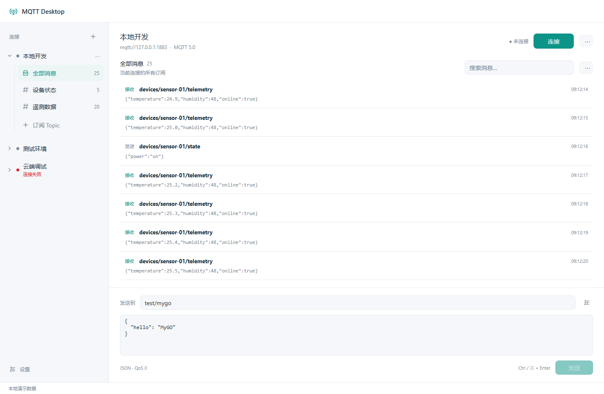
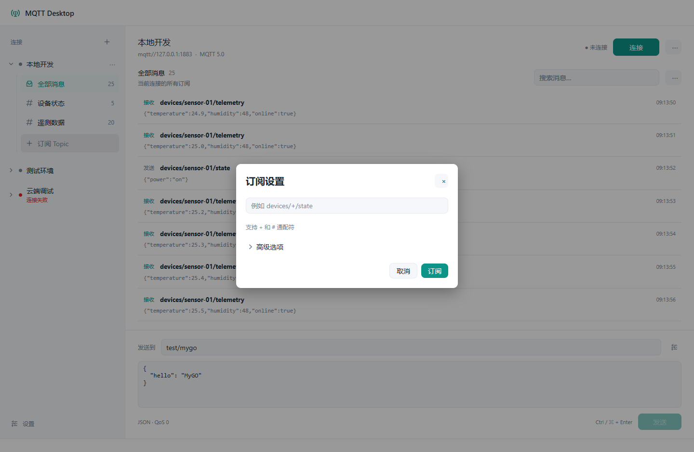
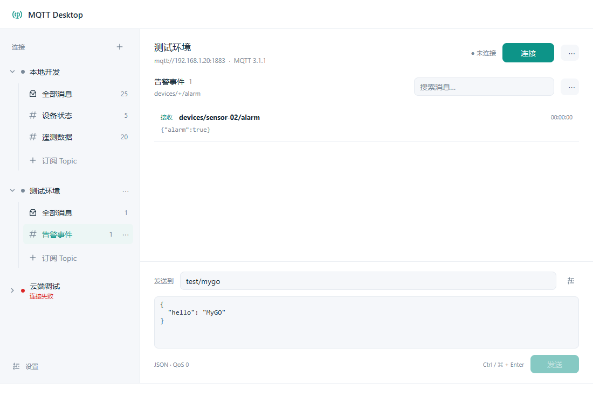
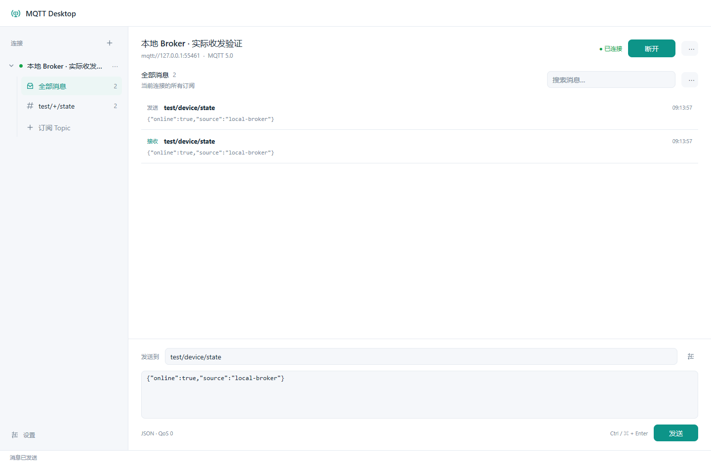
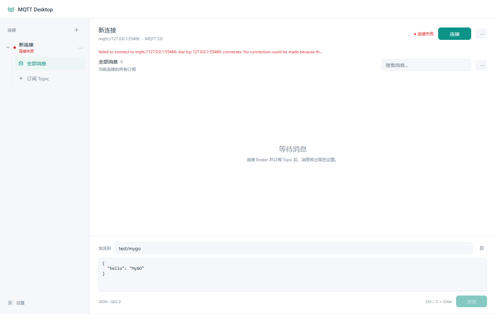
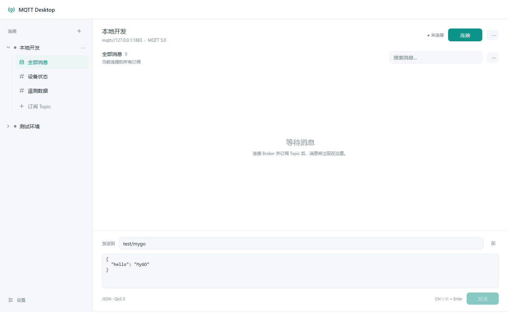

# MQTT Desktop

使用 [MyGO](https://mygo.egoist.dev/) 原生 Go UI 构建的轻量 MQTT 桌面客户端，面向日常设备调试：连接 Broker、订阅 Topic、实时查看和发布消息。界面以连接与订阅一体的列表为中心，复杂选项放在弹窗中。

当前提供 **Windows x64** 便携程序和安装包。使用 MyGO 0.2.7，不需要 Electron、浏览器运行时或 Node.js。

[下载最新版本](https://github.com/zhengchalei/MQTT-Desktop/releases/latest) · [查看 v0.1.0](https://github.com/zhengchalei/MQTT-Desktop/releases/tag/v0.1.0)



*主界面使用演示连接和消息数据，展示连接树、订阅筛选与发布区。*

## 功能

| 功能 | 支持内容 |
| --- | --- |
| 多连接管理 | 同时连接多个 Broker；创建、编辑、复制、删除和 JSON 导出配置 |
| 简洁的订阅列表 | 每个连接可展开、收起；订阅显示别名、完整 Topic 提示和缓存消息数量 |
| MQTT 协议 | MQTT 3.1.1、MQTT 5.0；QoS 0 / 1 / 2；Retain |
| 连接方式 | TCP、TLS、WebSocket、WSS；用户名与密码；系统 CA、自定义 CA、客户端证书和双向 TLS |
| 会话设置 | Keep Alive、连接超时、断线自动重连、Clean Session / Clean Start、会话有效期、遗嘱消息 |
| 订阅管理 | 多主题、`+` / `#` 通配符、添加和取消订阅；QoS、别名与颜色位于高级选项 |
| 消息发布 | Text、JSON、Hex、Base64；JSON 格式化；Ctrl+Enter 快捷发送 |
| 消息查看 | 实时消息列表、关键词搜索、Topic 与收发方向筛选、暂停自动滚动 |
| 消息操作 | 详情弹窗、多种编码查看、复制 Payload、填入发布区、JSON 导出、清空缓存 |
| 本地保存 | SQLite 保存连接配置与可选消息历史；分页读取历史；密码存入系统凭据存储 |
| 状态反馈 | 区分连接中、已连接、重连中和连接失败；失败时恢复“连接”，未连接时禁用发送 |
| 外观 | 浅色 / 深色主题；原生 Go 窗口；虚拟消息列表和有上限的内存缓存 |

## 界面截图

### 添加订阅

只需输入 Topic 即可订阅，QoS、别名和颜色收在“高级选项”中。



### 按连接查看订阅

点击另一个连接下的 Topic，自动切换到该连接并筛选消息。收起列表不会断开会话。



*此图使用本地演示数据，在 1100 × 740 的原生界面测试器中生成。*

### 实际 MQTT 收发

原生界面测试器连接真实本地 Broker，完成连接、订阅、发布、接收和历史读取。



### 连接失败

本地端口拒绝连接后，界面显示失败原因并恢复“连接”，发送按钮保持禁用。



### Windows 原生窗口

打包后的程序实际启动截图，使用单独的本地验证配置。



## 运行

从 [Releases](https://github.com/zhengchalei/MQTT-Desktop/releases/latest) 下载：

- **便携版**：解压 `MQTT-Desktop-0.1.0-windows-amd64.zip`，运行 `MQTT Desktop.exe`，保留同目录的 `icon.png`。
- **安装版**：运行 `MQTT Desktop Setup 0.1.0.exe`。
- **从源码构建**：运行 `go tool mygo build`，产物位于 `build/windows-amd64/`。

## 使用

1. 新建连接，输入 Broker 地址和 Client ID，选择 MQTT 3.1.1 或 5.0。
2. 根据 Broker 配置用户名、密码和 TLS 证书；保存后点击“连接”。
3. 左侧连接可展开或收起，订阅直接放在对应连接下面。点击该连接下的“订阅 Topic”，在弹窗输入主题，例如 `devices/+/state`，按 Enter 或点击订阅。QoS、别名和颜色位于“高级选项”。离线添加的订阅会在连接后自动订阅。
4. 在发布区输入主题和消息，点击发送或按 Ctrl+Enter（macOS 为 ⌘+Enter）；QoS、Retain 和编码放在“发送选项”弹窗中。
5. 点击消息打开详情弹窗，可复制或填入发布区；点击任意连接下的订阅，会切换到该连接并筛选主题。“全部消息”恢复该连接的所有消息，旁边数字表示实时缓存数量。收起连接只隐藏订阅，不会断开会话。
6. 选中或悬停订阅后，其右侧 `⋯` 可编辑别名和取消订阅，也可右键打开选项；连接右侧 `⋯` 可编辑、复制、导出、删除连接，消息右侧 `⋯` 可筛选方向、查看历史、导出或清空消息。设置位于左下角。

连接按钮区分“连接 / 取消连接 / 断开 / 取消重连”。首次连接失败时立即显示失败原因并恢复“连接”，不等待完整超时；发送按钮仅在连接成功时可用。底层收到网络错误或 Broker 断开通知后立即更新 UI，静默网络中断仍取决于连接超时与 Keep Alive。

支持 `mqtt://`、`mqtts://`、`ws://`、`wss://`。WebSocket 地址需要填写 Broker 对应路径，例如 `/mqtt`。

## 内存与保存规则

- 每个连接的实时缓存最多 2,000 条、16 MiB（以内容字节和记录开销估算）。
- 接收队列最多 256 条 / 8 MiB；历史写入队列最多 8 批 / 8 MiB。
- 单条发布上限 1 MiB；接收超过 1 MiB 时仅缓存前 1 MiB，并标记截断。
- MQTT 5 CONNECT 声明最大包大小 2 MiB。MQTT 3.1.1 客户端库仍需先接收完整协议包，再裁剪展示内容。
- 历史记录全局最多 10,000 条、128 MiB JSON 内容，旧记录自动删除；历史查看缓存最多 16 MiB。SQLite 会复用已释放页面，文件不会立即缩小。
- 队列满时丢弃展示/历史记录，界面显示计数；发布成功以 MQTT 客户端操作结果为准。
- 密码保存到系统凭据存储，不写入 SQLite 或连接导出文件。消息导出中的 Payload 为 Base64，保留二进制内容。
- 默认数据库位置：Windows `%APPDATA%/mqtt-desktop/data.db`。可用 `-data-dir <目录>` 指定其他目录。

## 开发与验证

需要 Go 1.27.1 或更高版本，默认 Go 自动工具链会下载所需版本；原生界面不需要 Bun 或 Node。本项目的成品与回归目前在 Windows x64 验证。

```powershell
go tool mygo dev
go test ./... -count=1 -timeout=90s
go vet ./...
go tool mygo build
```

测试使用进程内本地 MQTT Broker，覆盖两个 MQTT 版本与四种传输、QoS 0/1/2、取消订阅、Retain、双向 TLS、系统凭据与配置保存、历史分页和缓存上限，以及原生 UI 的连接、订阅、发布、接收和历史流程。Broker 测试依赖只用于测试，不进入成品。

```powershell
$env:MQTT_DESKTOP_EVIDENCE_DIR = "$PWD/docs/screenshots"
go test -run TestNativeBrokerWorkflow -count=1
go run . -screenshot docs/screenshots/demo.png
```

## 当前边界

首版尚未提供 MQTTX 配置导入、脚本转换、定时发送、完整 MQTT 5 属性编辑、Topic 树、托盘和自动更新。当前安装包未签名。尚未与 MQTTX 在同一负载下进行内存对比，也未完成长时间运行测量。

2026-10-05 本机 Windows x64 空闲启动约 2 秒：工作集 33.2 MiB、私有内存 55.5 MiB，子进程数 0。这是单次空闲启动观测。

本地 MQTT 5 测试发送并接收 5,000 条、每条 2,048 字节的消息，缓存保持 2,000 条，淘汰 3,000 条，内容估算 4,378,000 字节。此测试验证缓存边界，不代表成品总内存或网络吞吐上限。

## 使用的项目

- [MyGO](https://github.com/egoist/mygo)：原生 Go 界面与打包工具。
- [Eclipse Paho MQTT 3](https://github.com/eclipse/paho.mqtt.golang) / [MQTT 5](https://github.com/eclipse/paho.golang)：MQTT 客户端。
- [modernc SQLite](https://pkg.go.dev/modernc.org/sqlite)：本地配置和历史存储。
- [go-keyring](https://github.com/zalando/go-keyring)：系统凭据存储。
- [Mochi MQTT](https://github.com/mochi-mqtt/server)：本地回归测试 Broker，仅用于测试。
